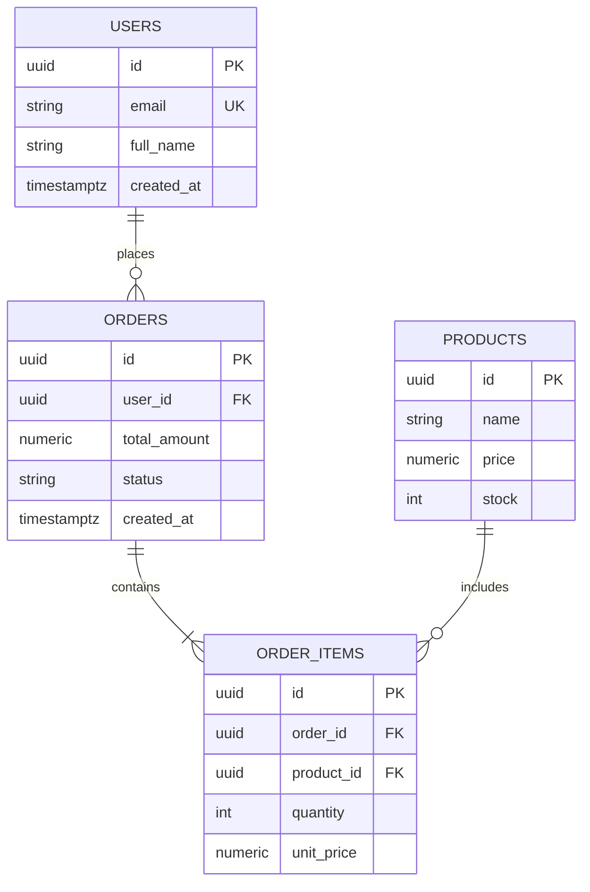

# Protocolo Maestro de Diseño de Bases de Datos (Database Schema Designer)

Este skill define el estándar de oro de la industria (OneWave-AI / PlanetScale / System Design) para diseñar, modelar y auditar bases de datos relacionales y no relacionales con cero errores de arquitectura.

---

## 0. Principios Inquebrantables de Persistencia
1. **Normalización Estricta (1NF a 3NF):** Ninguna tabla o colección puede almacenar datos atómicos repetidos ni dependencias transitivas.
2. **Prohibición Total de Muchos a Muchos (M:N) Directos:**
   * Jamás relaciones dos entidades directamente en N:N sin una **tabla pivote / intermedia**.
   * La tabla intermedia DEBE tener su propia clave primaria o clave compuesta `(id_a, id_b)` con índices bidireccionales y timestamps `created_at`.
3. **Indexación Obligatoria de Claves Foráneas (FKs):**
   * Toda clave foránea DEBE tener un índice (`CREATE INDEX idx_tabla_fk ON tabla(fk_id)`). Dejar una FK sin índice causa escaneos de tabla completa (*table scans*) catastróficos.
4. **Tipado Semántico Real:**
   * Fechas: `TIMESTAMPTZ` o `DateTime` (nunca strings planos ni timestamps UNIX en enteros sin zona horaria).
   * Moneda / Precisión: `NUMERIC(12, 2)` o `DECIMAL` (nunca `FLOAT` o `DOUBLE` que causan errores de redondeo financiero).
   * Identificadores: `UUID v7` (ordenables en el tiempo) o `BIGINT IDENTITY` / `BIGSERIAL`.
   * Textos: `VARCHAR(N)` o `TEXT` con validación `CHECK`.

---

## 1. Motores Relacionales (PostgreSQL, Supabase, MySQL, SQLite)

### A. Anatomía Obligatoria de Cada Tabla
```sql
CREATE TABLE public.orders (
    id UUID PRIMARY KEY DEFAULT gen_random_uuid(),
    user_id UUID NOT NULL REFERENCES public.users(id) ON DELETE RESTRICT,
    total_amount NUMERIC(10, 2) NOT NULL CHECK (total_amount >= 0),
    status VARCHAR(20) NOT NULL DEFAULT 'pending' CHECK (status IN ('pending', 'paid', 'shipped', 'cancelled')),
    created_at TIMESTAMPTZ NOT NULL DEFAULT timezone('utc'::text, now()),
    updated_at TIMESTAMPTZ NOT NULL DEFAULT timezone('utc'::text, now())
);

-- Índices obligatorios en FKs y campos de búsqueda frecuente
CREATE INDEX idx_orders_user_id ON public.orders(user_id);
CREATE INDEX idx_orders_status ON public.orders(status);
```

### B. Reglas de Supabase y PostgreSQL RLS (Row Level Security)
Toda tabla expuesta en Supabase o PostgreSQL multi-inquilino DEBE tener RLS activado:
```sql
ALTER TABLE public.orders ENABLE ROW LEVEL SECURITY;

CREATE POLICY "Users can only read their own orders"
    ON public.orders FOR SELECT
    USING (auth.uid() = user_id);
```

---

## 2. Motores No Relacionales (Firestore, MongoDB)

### A. Firebase Firestore (Optimización de Costos y Lecturas)
1. **Colecciones Raíz vs Subcolecciones:**
   * Usa **Subcolecciones** solo si los datos siempre se leen en cascada y están estrictamente acotados (<100 elementos, ej. `users/{userId}/addresses/{addressId}`).
   * Si la colección puede crecer indefinidamente o requiere consultas globales (ej. pedidos, transacciones), usa **Colección Raíz** con campo `userId` e índice compuesto.
2. **Denormalización Quirúrgica:**
   * Solo denormaliza datos inmutables para la UI rápida (ej. guardar `userName` y `userAvatar` dentro de un comentario para evitar 1 lectura extra por cada comentario).

### B. MongoDB
* Usa esquemas validados con Mongoose o JSON Schema Validation.
* Define índices compuestos para queries frecuentes (`db.collection.createIndex({ userId: 1, createdAt: -1 })`).

---

## 3. Visualización Obligatoria: Diagramas ERD en Mermaid
Siempre que se diseñe o audite un modelo de base de datos, DEBE acompañarse de un diagrama `erDiagram` de Mermaid:


