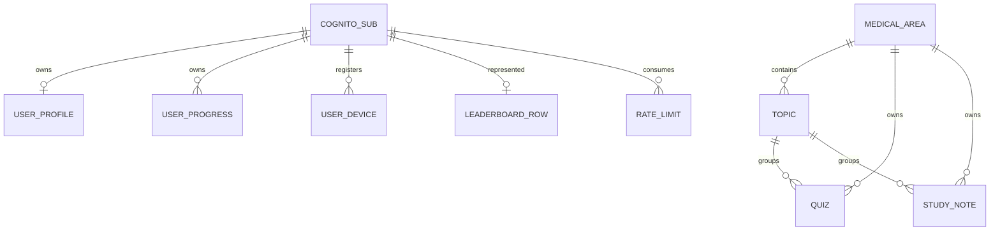

# AWS backend migration

The mobile application runtime uses AWS for accounts, API requests, catalog and user data. The
catalog importer reads only approved education content and never reads user profiles or progress.

## Components and authorization

- Cognito User Pool Lite: new email/password accounts and email confirmation/recovery.
- Public mobile client: authorization code with PKCE; no client secret; rotating refresh tokens.
- Cognito access-token signature/issuer/client/token_use/expiry verification with aws-jwt-verify.
- Online GetUser check rejects revoked sessions and disabled users; identity comes only from verified claims.
- API Gateway HTTP API and Node.js 22 Lambda; no identity-provider admin SDK in the AWS runtime.
- Nine purpose-specific DynamoDB tables with flat English attributes, encryption and TTL for rate counters. The legacy table remains retained and is not read by the new runtime.
- CloudWatch Lambda/API logs retain seven days; no authorization headers, tokens, bodies or health data logged.
- Optional S3 private encrypted/versioned bucket is disabled: the app has no file upload flow to migrate.
- AWS runtime dependencies contain no mobile push SDK or identity-provider admin SDK.

Lambda IAM is scoped to four catalog tables and the exact user, progress, ranking, device and rate-limit tables.
Owner writes use `USER#<verified-sub>` keys; the API cannot scan tables, create resources, administer Cognito,
or access a customer-managed KMS key.
The API derives the owner from the verified subject and rejects client owner/role fields.

## API contracts

All successful responses use `{data, requestId}`; errors use `{error:{code,message},requestId}`.
Pagination returns `{items,nextCursor}`; collection cursors are bound to their partition/prefix.
All routes except health require a Cognito access token. Anonymous login is not implemented.

| Method | Path | Result |
| --- | --- | --- |
| GET | /health or /api/v1/health | Public liveness; no database/auth access |
| GET | /api/v1/auth/session | Verified subject and public identity metadata |
| GET/PUT/PATCH | /v1/me/profile | Profile; new account GET returns an empty object |
| GET | /api/v1/areas | Medical areas |
| GET | /api/v1/areas/{area}/topics | Topics |
| GET | /api/v1/areas/{area}/topics/{topic}/study-notes | Study notes |
| GET | /api/v1/areas/{area}/topics/{topic}/quizzes | Quizzes |
| GET | /api/v1/areas/{area}/quizzes?topicId=... | Legacy catalog shape supported in AWS only |
| GET | /api/v1/progress/me | Current progress and version per topic |
| POST | /api/v1/progress/{topic}/answer | Canonical score and updated progress |
| POST | /api/v1/progress/{topic}/retry | Archive answered attempt, preserve FIFO3, reset |
| GET | /api/v1/history and /api/v1/history/{id} | Existing owner-bound history contract |
| GET | /api/v1/leaderboard | Server-published ranking rows; no client write route |

Profile writes allow name/career/gender only; email/provider/uid come from verified identity.
Answer writes accept areaId, quizId, expectedAttemptNumber and answer, never trusted stars or correctness.
Single choice answer: `{selectedOptionText,selectedOptionIndex?}`; matching: `{pairs:[{left,right}]}`;
ordering: `{items:[string]}`. The server validates against its own catalog, allowing display shuffling.
Retry accepts areaId, expectedAttemptNumber, idempotencyKey (16-128 URL-safe characters) (totalMaxStars accepted for compatibility
but recomputed from catalog). Contradictory answer replay and stale attempts return 409.

Progress and cumulative ranking are committed in one DynamoDB transaction with version conditions.
A repeated answer cannot count twice. Concurrent topics cannot lose ranking increments.
Ranking totalStars and completedQuizzesCount derive from accepted canonical answers. Existing answer
contracts have no trustworthy start clock: totalQuizTimeSeconds and averageTimeSeconds remain null;
this migration does not invent timing measurements. The app should display unknown duration accordingly.
Private history retains the existing maximum three archived attempts per topic plus the active attempt;
ranking totals remain cumulative. History over 200 topics fails explicitly rather than truncating.

## DynamoDB structure



| Table | Partition key | Sort key | Row contents |
| --- | --- | --- | --- |
| Medical areas | `AREAS` | `AREA#<areaId>` | Name, code and catalog counts |
| Topics | `AREA#<areaId>` | `TOPIC#<topicId>` | Area-owned topics |
| Quizzes | `AREA#<areaId>` | `TOPIC#<topicId>#QUIZ#<quizId>` | Questions, choices and answers |
| Study notes | `AREA#<areaId>` | `TOPIC#<topicId>#STUDY_NOTE#<noteId>` | Summary and study content |
| User profiles | `USER#<cognitoSub>` | `PROFILE` | Profile; fixed career/gender values stored in English |
| User progress | `USER#<cognitoSub>` | `TOPIC#<topicId>` | User-owned attempts and answer snapshots |
| Leaderboard | `LEADERBOARD` | `USER#<cognitoSub>` | Server-calculated ranking projection |
| Rate limits | `RATE#<cognitoSub>` | `WINDOW#<minute>` | Request count and TTL |

Domain attributes are top-level English columns; API adapters reconstruct the existing response shape.
The catalog hierarchy is one-to-many. Progress is user-owned and stores answer snapshots; there are no
many-to-many junction tables. Stable IDs remain identifiers for app compatibility. Names, email addresses and
arbitrary user-entered profile text are not translated. The old `AppTable` remains retained and untouched as a
rollback copy; no existing user or progress records are copied into the new tables.

## Local verification and artifact

```powershell
npm ci
npm test
npm run test:aws
uvx --from cfn-lint cfn-lint template.json
npm run package:aws
```

The split-table catalog migration reads only medical areas, topics, quizzes and legacy study-note paths from the retained
legacy table. It uses the open-source Opus-MT Spanish-to-English model through Transformers.js on the local PC;
text is not sent to Amazon Translate or another translation API. Configure `LEGACY_CATALOG_TABLE_NAME` and
the four catalog table names, then run `npm run migrate:catalog` for a dry run or
`npm run migrate:catalog -- --apply` to write English content into the new tables. It never reads profiles,
ranking, devices or progress. The first run downloads model files from Hugging Face into the local package
cache; they are not included in the Lambda deployment archive.

Build syntax-checks all modules, enforces 250 lines and generates template.json from infra/*.mjs.
The ZIP at dist/synapse-health-aws.zip includes AWS runtime source and production dependencies only.
No mobile SDK, real tokens, credentials, datasets or test fixtures enter it.
Tests cover real RSA/JWKS verification with synthetic keys, service failures, owner isolation,
empty catalogs, scoring, CAS transactions, replay/FIFO, ranking, cursor isolation and IaC constraints.
Local tests do not prove deployed IAM, Cognito email delivery or push delivery.

## Deployment gates and costs

DeploymentApproved=false creates no resources. Before changing it, recheck account identity,
FREE account plan, remaining credits/expiry, regional prices and final security review. No paid-plan
upgrade, NAT gateway, WAF, provisioned Lambda concurrency, SMS MFA or paid Cognito tier is configured.
The eight active tables use a combined 15 RCU/15 WCU; including the retained 5/5 legacy table, this is
20 RCU/20 WCU in `us-east-2`, below DynamoDB's 25/25 always-free allowance. Lambda, API requests,
log ingestion/storage, data storage/transfer and artifact storage still need account-level monitoring.
HTTP throttling 5 requests/second with burst 10 and per-user quota 120/minute reduce accidental usage;
these are not monetary spending caps. Credits expire and do not protect against every charge category.

ArtifactBucket/ArtifactKey must identify an approved private deployment artifact. These are not app data.
The template defaults are deliberately unconfigured. Stateful table, user pool, bucket and logs use Retain.
S3 stays disabled until an existing app file service actually needs it and costs are approved.
CloudWatch service metrics remain available; paid detailed metrics/alarms are not enabled.

Outputs provide ApiBaseUrl, CognitoUserPoolId, CognitoClientId, CognitoRegion and CognitoDomain.
Flutter uses SYNAPSE_API_BASE_URL, SYNAPSE_COGNITO_USER_POOL_ID, SYNAPSE_COGNITO_CLIENT_ID,
SYNAPSE_COGNITO_REGION and SYNAPSE_COGNITO_DOMAIN. All are public identifiers; never embed AWS keys.

## Notifications

Cognito email/password authentication remains the only account login. The mobile app supports local notifications only; it has no remote push integration.

The mobile callback is com.synapsehealth.auth://callback; logout is com.synapsehealth.auth://logout.
OAuth scopes include openid/email/profile/aws.cognito.signin.user.admin for online GetUser checks.
Use PKCE and state validation. Cognito subjects are not implicitly linked to identities from another provider by email.

Local notification display and interaction are handled on-device. The AWS API has no device-token endpoint or notification sender. A previously deployed `user-devices` table is retained and no longer accessed; this change does not delete its existing items.

## Local control center

Run `npm run admin` from `backend/` after authenticating the AWS CLI. Open `http://127.0.0.1:4178`.
The read-only Node server binds only to loopback, uses the AWS SDK credential chain on the PC, and never
returns AWS credentials to the browser. It lists DynamoDB tables in `us-east-2`, reads the selected table
sequentially in 25-item pages with a 500 ms pause, and shows cumulative read capacity. Selecting a table
reads all its items, so large tables can take time and consume read capacity. Cognito users refresh every
30 seconds. It creates no AWS resources.
Close the terminal running the server to stop it. Required read permissions are DynamoDB ListTables/Scan
and Cognito ListUsers for the configured user pool.
