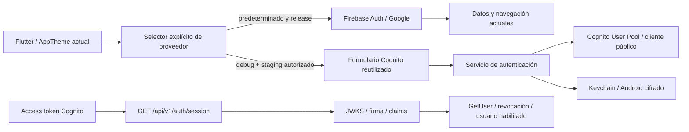

# AWS Parte 2 — Autenticación Cognito

Estado: implementación y pruebas locales terminadas, con dependencias AWS simuladas donde corresponde. Cognito no está desplegado ni activo en producción. Firebase y Google continúan como acceso actual. Fecha: 2026-10-12.

## Alcance y arquitectura

El servicio usa APIs públicas JSON de Cognito sobre HTTPS y el almacenamiento seguro ya instalado. No incorpora SDK nativo Flutter ni cambia FlutterFire/Pods. La nueva dependencia backend aws-jwt-verify verifica criptografía y claims; no se escribe otro verificador JWT artesanal.

La interfaz de transición reutiliza AuthLoginForm, AuthModeSelector, AuthTextField y AppTheme; confirmación y recuperación son pasos del mismo flujo. No duplica pantallas académicas ni rediseña el resto. Cuenta Cognito válida muestra una sesión de transición, sin convertir sub en Firebase User ni otorgar acceso a Firestore.

## Configuración SAM

`EnableCognitoAuth=false` por defecto mantiene los recursos desactivados. Plantilla preparada:

- User Pool con login por correo, case-insensitive, verificación de email por código y recuperación mediante correo verificado.
- Cliente público Flutter, `GenerateSecret=false`; solo atributos email/name modificables, nunca email_verified.
- Contraseña mínima12, mayúscula/minúscula/número/símbolo; Cognito gestiona las contraseñas, no DynamoDB.
- Access e ID tokens15min; refresh7d; revocación y rotación habilitadas, gracia10s; GetTokensFromRefreshToken, sin REFRESH_TOKEN_AUTH incompatible.
- PreventUserExistenceErrors habilitado. MFA está desactivado en esta base; desafíos adicionales se rechazan con mensaje seguro, no se evaden. MFA/SSO se planifican después de validar este flujo.
- Email COGNITO_DEFAULT, sin SES/SMS añadido; entrega/cuotas/región requieren validación real. Retain preserva User Pool ante retirada del stack.
- Outputs PoolId, AppClientId y Region; Lambda recibe únicamente identificadores públicos, sin secreto móvil. No se añaden permisos administrativos Cognito a IAM.

Formato/rotación según [CloudFormation UserPoolClient](https://docs.aws.amazon.com/AWSCloudFormation/latest/TemplateReference/aws-resource-cognito-userpoolclient.html) y [refresh tokens Cognito](https://docs.aws.amazon.com/cognito/latest/developerguide/amazon-cognito-user-pools-using-the-refresh-token.html).

## Flujos implementados

| Flujo | Operaciones |
| --- | --- |
| Registro | SignUp con correo/nombre/contraseña; sin almacenamiento de contraseña |
| Confirmación | ConfirmSignUp, ResendConfirmationCode; login requiere cuenta confirmada |
| Login | InitiateAuth USER_PASSWORD_AUTH sobre TLS directo Cognito |
| Recuperación | ForgotPassword y ConfirmForgotPassword; textos genéricos |
| Restauración | Lee almacenamiento seguro, valida estructura/issuer/client/sub/exp; renueva si corresponde |
| Renovación | GetTokensFromRefreshToken, refreshtoken rotado y escritura serializada |
| Cierre | Limpieza local primero, GlobalSignOut; informa si revocación remota no pudo confirmarse |

La sesión restaura una sola vez antes de mostrar formulario, renueva al reanudar/vencer y no guarda contraseñas/códigos. Contraseña/código se limpian al completar pasos o recibir sesión. Peticiones concurrentes de renovación se agrupan; logout/dispose invalidan respuestas tardías, impidiendo resucitar sesión. Un vencimiento con fallo offline retira la vista autenticada pero conserva caché segura para reintentar renovación.

Tokens solo en memoria y FlutterSecureStorage: Keychain unlocked_this_device en iOS; cifrado del plugin existente en Android. No SharedPreferences ni archivos/env para tokens. Validación en dispositivo de JWT es de estructura/claims, **no de firma**: respuestas nuevas se reciben por TLS de AWS y cualquier acceso backend vuelve a verificar criptográficamente.

Errores de red, timeout, códigos incorrectos, contraseña inválida, exceso de solicitudes y cuenta pendiente se traducen a mensajes seguros. No se muestran mensajes internos, tokens ni contraseñas. PreventUserExistenceErrors no oculta todas las respuestas de SignUp del proveedor; la UI usa mensajes genéricos, sin prometer eliminar toda enumeración de la API pública.

## Ruta privada y autorización

`GET /api/v1/auth/session` requiere Bearer access token Cognito y devuelve solamente `{data:{sub},requestId}`. Comprueba JWKS/firma RSA, issuer/pool, client_id, token_use=access, exp válido y subject. Un ID token no sirve para este endpoint. Después consulta GetUser y compara sub, rechazando usuarios deshabilitados o tokens revocados. JWT offline solo no demuestra revocación. [Verificación de tokens AWS](https://docs.aws.amazon.com/cognito/latest/developerguide/amazon-cognito-user-pools-using-tokens-verifying-a-jwt.html).

401 para token inválido/expirado/revocado;503 si falta configuración o falla proveedor;405 método incorrecto y400 query/body inválidos. Manejo centralizado/CORS/logs existentes. Throttling compartido API Gateway10/s y burst20; no se afirma cuota persistente por usuario Cognito. APIs de registro/login directas usan controles/cuotas administrados de Cognito, no un proxy Lambda que registre contraseñas.

History/profile mantienen su validador Firebase, UID y permisos previos. Tokens Cognito no acceden a esas rutas; tokens Firebase tampoco abren la sesión Cognito. No se crean mappings implícitos por email ni registros académicos. GetUser es autorizado por access token; no necesita permiso IAM administrativo. Roles existentes conservan alcance de logs/secreto Firebase.

## Activación de pruebas y producción

Configuración pública Flutter mediante dart-define:

- SYNAPSE_AUTH_PROVIDER=firebase por defecto.
- Para pruebas: cognito más SYNAPSE_COGNITO_STAGING=true.
- SYNAPSE_COGNITO_REGION, SYNAPSE_COGNITO_USER_POOL_ID y SYNAPSE_COGNITO_CLIENT_ID deben corresponder a recursos reales validados.

`AuthProviderGate` rechaza Cognito en release, sin staging explícito o con configuración incorrecta. Ofrece continuar con Firebase; al cambiar limpia sesión Cognito y conserva el flujo Firebase/Google. Esta autorización de desarrollo no habilita producción. Activación release requiere aprobación y cambio explícito posterior.

No se altera la inicialización de Firebase, FCM, Crashlytics o Firestore ni el uso de Google actual. En modo Cognito no se navega a datos médicos con identidad Firebase fabricada.

## Google y migración pendiente

Google sigue en Firebase. Para migrarlo posteriormente: proveedor federado Google en User Pool, secreto Google solo en AWS, dominio Cognito y authorization code + PKCE, redirect allowlist/deep links iOS/Android, state/nonce y pruebas de sesión/logout. No se implementan ahora ni se incrusta secreto en Flutter.

Antes de migrar datos, verificar ambas identidades y crear correspondencia auditada Firebase UID ↔ Cognito sub. No vincular cuentas solo porque coincidan emails. Conservar Firestore/UID/originales y rollback hasta comprobar equivalencia de autorizaciones, historiales, progreso, perfil y Google. DynamoDB permanece inactivo.

## Pruebas y evidencia

- Flutter analyze: sin incidencias.
- Flutter test: 206 aprobadas:166 previas +22 núcleo,13 UI y5 selector de proveedor.
- Backend Node.js22:119 aprobadas (41 nuevas Cognito) y4 smoke HTTP health previas.
- Pruebas backend firman RSA y usan JWKS local real, sin claves guardadas; verifican tokens expirados/issuer/client/tipo/firma/sub/exp ausente y acceso entre proveedores. GetUser se simula para revocación, disableduser, red/throttle y sub distinto.
- Pruebas Flutter simulan únicamente transporte y almacenamiento para registro, confirmación, reset, login, sesión, errores, concurrencia y cierre. No se crean usuarios AWS ni se envían correos.
- TypeScript typecheck/build y SAM CLI validate --lint: correctos. npm audit producción:0 vulnerabilidades.
- iPhone17/iOS26.5: app real compiló19,9s/sync128ms y arrancó con Firebase; hot reload final del selector correcto. Vista Cognito aislada con transporte sin red y almacén vacío compiló23,1s/sync110ms, captura marcada como prueba. Arranque Firebase restaurado después de esta vista: build18,9s/sync125ms, VM activa. Aviso UIScene previo de Google Sign-In persiste.
- codebase-memory no disponible; inspección directa/acotada. Revisión Git/secrets antes de commits. Fuente nueva ≤250líneas.

## Pendiente de validar en AWS

Despliegue expresamente autorizado, región/cuenta/costos, recursos reales, correo/códigos, política de contraseña, cuotas, rotación/gracia, revocación y acceso con JWKS real. Probar Keychain/Android en dispositivos, reinstalación/backup, red y expiración antes de activar producción. Sin AWS desplegado no se declara autenticación funcionando en producción ni migración completada.

Cambios: backend template/env/dependencia/JWT/ruta/tests; lib/main.dart, AuthProviderGate, módulos Cognito api/model/ui y pruebas; documentación y captura. No cambiar main/testIv ni avanzar a Parte3. No despliegues, migraciones ni activación de producción.

Código publicado en feat/janely-synapse-development: b9103a43662da23b0355f1dd39dfde046964d6d0 (backend/SAM) y 24bb3556a2d6ecad48c77640bf1f2da2bfaf1b5b (Flutter/sesiones). Publicación verificada por GitHub API y git ls-remote, cuenta Janely con permisos push. Esta documentación y la captura se publican en un commit separado.
