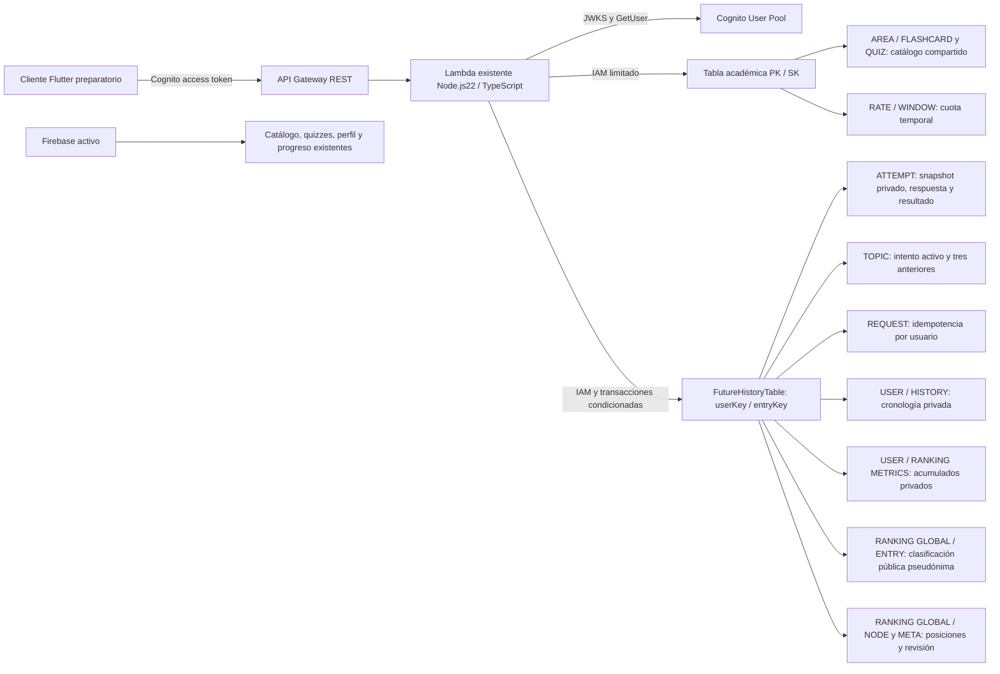

# AWS — DynamoDB y API académica (Partes 3, 4 y 5)

Estado: implementación y pruebas locales de fichas, quizzes, resultados y progreso; sin despliegue AWS ni migración de Firebase.
Rama: `feat/janely-synapse-development`. Base publicada de Parte 2: `b9f7cf68419dc66fdf7f72cf92714b78289856d9`.

## Auditoría del modelo real

| Entidad existente | Acceso actual | Decisión en esta parte |
| --- | --- | --- |
| MedicalAreaModel | Catálogo Firestore, orden y disponibilidad | Sigue en Firebase; no se crea otra tabla |
| TopicModel | Temas por área, orden y conteos | Sigue en Firebase |
| CheatsheetModel | Fichas por área/tema, contenido Markdown | Primer CRUD DynamoDB; conserva sus campos |
| QuizModel | Preguntas por área/tema | Sigue en Firebase; sin migración |
| Usuario | Firebase Auth/perfil; Cognito solo staging debug | Sin mezclar UID Firebase y sub Cognito |
| QuizTopicProgressModel / QuizAttemptModel | Progreso por usuario/tema, intento activo y hasta tres históricos | Conservados en Firebase |
| ProgressSummary / historial académico | Estadísticas derivadas e intentos realmente retenidos | No se recalculan ni migran |

El servicio `medical_areas_service.dart` mantiene las lecturas existentes. El nuevo cliente es preparatorio y se verifica con transporte local en pruebas; Flutter no consume este CRUD en producción. No hay interfaz administrativa nueva, cambios de diseño ni datos precargados.

## Modelo y patrones de acceso

Una tabla compartida de contenido académico, sin tabla por entidad. El contenido privado no se mezcla: la tabla futura de historial ya existente sigue desactivada.

| Registro | PK | SK | Atributos |
| --- | --- | --- | --- |
| Ficha | `AREA#<areaId>` | `FLASHCARD#<UUIDv4>` | Campos del modelo, id, version, createdAt, updatedAt |
| Cuota temporal | `RATE#<SHA256(sub)>` | `WINDOW#<inicio-segundos>` | count, expiresAt |

Campos de ficha: `areaId`, `topicId`, `title`, `summary`, `contentMarkdown`, `keyPoints`, `mnemonics`, `readDurationInMinutes`, `isPremium`, `sourceBook`. El alias heredado `readMinutes` no se envía a esta API. `isPremium` es metadato: esta parte autoriza lectura por autenticación y no implementa pagos o nuevas reglas de suscripción.

- UUIDv4 y fechas UTC se generan en el servidor. `id` es base64url canónico de `[areaId, UUIDv4]`; contiene ubicación, nunca un secreto. PK/SK internos no se devuelven.
- `areaId` es inmutable. IDs de área/tema: letras, números, guion y guion bajo, longitud 1–128. Crear/cambiar referencias no consulta Firestore: se valida formato, no existencia. Antes de activar/importar, debe aprobarse el mapeo de catálogo; no hay claves foráneas automáticas.
- Listar exige área; Query por PK y prefijo de SK, con filtro opcional de tema. No Scan ni GSI: no se requiere lectura global o búsqueda por otro atributo en esta fase.
- Límite predeterminado 20, máximo 50 elementos evaluados. Un filtro puede producir página vacía con cursor: continuar hasta `nextCursor=null`. Cursor ligado a área/tema/última clave; orden por UUID, no cronológico.
- Lecturas consistentes. PATCH/DELETE requieren `If-Match: "<version>"`; escrituras condicionales evitan sobrescrituras. Versión obsoleta:409; ficha ausente:404. Crear también usa condición de ausencia.
- TTL solo se establece en contadores, nunca en fichas; la expiración física es eventual y no determina autorización. Cuota de ventana fija, no límite deslizante: dos ventanas contiguas pueden admitir dos cuotas.



## Contrato REST

| Método y ruta | Acceso | Éxito |
| --- | --- | --- |
| GET /api/v1/flashcards?areaId=...&topicId=...&limit=20&cursor=... | Cognito autenticado | 200, data:{items,nextCursor} |
| GET /api/v1/flashcards/{id} | Cognito autenticado | 200, data:ficha, ETag |
| POST /api/v1/flashcards | Grupo firmado admins | 201, data:ficha, ETag y Location |
| PATCH /api/v1/flashcards/{id} | Grupo admins + If-Match | 200, data:ficha y ETag nuevo |
| DELETE /api/v1/flashcards/{id} | Grupo admins + If-Match | 204, cuerpo vacío |

Errores JSON: `{error:{code,message},requestId}`; mensajes seguros. 400 entrada/versión/cursor inválidos;401 token ausente/inválido;403 escritura no administrativa;404 ausente;409 conflicto;429 cuota excedida con Retry-After;500 fallo interno inesperado;503 servicio/cuota no disponible. También405 método incorrecto,413 cuerpo mayor de16KiB y415 Content-Type incorrecto. Sin trazas internas; logs solo requestId/código seguro.

POST requiere área, tema, título y Markdown; los campos opcionales tienen valores vacíos/cero/false compatibles con el modelo. PATCH acepta únicamente campos académicos mutables. No se aceptan roles, versiones o fechas proporcionados por clientes.

## Seguridad, configuración e infraestructura

- Cognito: firma/JWKS, issuer/client/token_use/exp/sub y GetUser para revocación/usuario deshabilitado. Firebase tokens no autorizan este CRUD. Grupos provienen del JWT firmado, nunca de body/headers de rol.
- Grupo `admins` vacío preparado por SAM; inscripción no otorga administración. Asignación requiere operación administrativa explícita después del despliegue autorizado. Al retirar privilegios, revocar sesiones: la pertenencia de un JWT vigente no se reconsulta por grupo hasta renovar.
- IAM Lambda permite únicamente GetItem/PutItem/UpdateItem/DeleteItem/Query en la tabla condicionada, además de permisos anteriores. No Scan, creación de tablas ni administración de usuarios Cognito.
- Tabla on-demand, cifrado, PITR y Retain. CloudWatch y Gateway throttling existentes se reutilizan. Cuota atómica por usuario en DynamoDB, SHA256 del sub y TTL. CORS de origen exacto, If-Match permitido, ETag/Location/Retry-After expuestos; CORS no sustituye autorización.
- `EnableCognitoAuth=false`, `EnableFlashcardCrud=false` y `EnableDynamoHistory=false` por defecto. SAM rechaza CRUD activado sin Cognito. Rutas preparadas fallan cerradas cuando faltan pool/tabla.
- `FLASHCARDS_TABLE_NAME`: generado por SAM; `FLASHCARDS_RATE_LIMIT`:60 solicitudes/minuto, rango1–1000; `COGNITO_USER_POOL_ID`, `COGNITO_CLIENT_ID` y `ALLOWED_ORIGIN` existentes. Ejemplo sin secretos en `backend/.env.example`.
- Credenciales DynamoDB se obtienen del rol Lambda; sin claves AWS en Flutter. Runtime no permite redirigir DynamoDB a endpoints arbitrarios mediante variables. SDK: tres intentos, conexión2s y solicitud5s.

## Pruebas locales reproducibles

Requisitos: Node.js22, npm, Java y SAM CLI. Sin Docker, cuenta AWS o despliegue. DynamoDB Local solo conserva fixtures no clínicos en memoria; cada prueba crea y elimina su tabla temporal. Credenciales `local/local` son valores de firma del emulador, no claves AWS.

```sh
npm ci --prefix backend
npm run typecheck --prefix backend
npm test --prefix backend
npm run test:health --prefix backend
mkdir -p /tmp/synapse-dynamodb-local
curl --fail --location https://s3.us-west-2.amazonaws.com/dynamodb-local/dynamodb_local_latest.tar.gz -o /tmp/synapse-dynamodb-local/archive.tar.gz
tar -xzf /tmp/synapse-dynamodb-local/archive.tar.gz -C /tmp/synapse-dynamodb-local
cd /tmp/synapse-dynamodb-local
java -Djava.library.path=./DynamoDBLocal_lib -jar DynamoDBLocal.jar -inMemory -sharedDb -port 8000
# En otra terminal, desde la raíz del repositorio:
DYNAMODB_LOCAL_ENDPOINT=http://127.0.0.1:8000 npm run test:dynamodb --prefix backend
SAM_CLI_TELEMETRY=0 AWS_EC2_METADATA_DISABLED=true sam validate --lint --template-file backend/template.yaml --region us-east-1
flutter analyze
flutter test
```

El servidor HTTP de integración usa loopback y verifica el CRUD completo sobre DynamoDB Local; su transporte de identidad es una fixture, mientras las firmas RSA/JWKS Cognito se verifican en pruebas separadas. Esto no demuestra una sesión o URL real de AWS. El emulador no verifica IAM, CloudWatch, cifrado/PITR o TTL físico: quedan para staging autorizado.

Referencias: [paginación y páginas filtradas](https://docs.aws.amazon.com/amazondynamodb/latest/developerguide/Query.Pagination.html), [escrituras condicionales por versión](https://docs.aws.amazon.com/amazondynamodb/latest/developerguide/BestPractices_OptimisticLocking.html), [grupos firmados de Cognito](https://docs.aws.amazon.com/cognito/latest/developerguide/cognito-user-pools-user-groups.html).

Pendiente: autorización de despliegue, región/cuenta/costos, usuarios administrativos reales, pruebas staging IAM/tokens/endpoint y mapeo/importación auditada del catálogo. Ninguna migración o avance a Parte4 ejecutado.

## Resultado ejecutado (2026-10-12)

- TypeScript typecheck/build correctos. Node.js22:184 pruebas backend y4 HTTP health aprobadas.
- DynamoDB Local:3 integraciones aprobadas (repositorio, HTTP CRUD y cuota distribuida); tablas temporales eliminadas y servidor detenido.
- 61 solicitudes de cuota concurrentes:60 aceptadas y1rechazada con429; aislamiento y nueva ventana verificados.
- SAM CLI1.168.0 validate --lint:plantilla válida. npm audit producción:0 vulnerabilidades.
- Flutter analyze sin incidencias;248 pruebas aprobadas. Ningún cambio UI/nativo: no se ejecutó una nueva compilación iOS en esta parte.
- Revisión final de diferencias y secretos antes de publicar; sin despliegues AWS, migración, producción Cognito o usuarios administrativos creados.

Commits de código publicados y verificados en GitHub:

- [cd2dc1349e812bb1f88a8ec7b7ba523e105ec236 — backend](https://github.com/bryanapazaquispev5-droid/synapse-health/commit/cd2dc1349e812bb1f88a8ec7b7ba523e105ec236).
- [5ff5846d8851c75791d7249540201c0ca737c732 — Flutter](https://github.com/bryanapazaquispev5-droid/synapse-health/commit/5ff5846d8851c75791d7249540201c0ca737c732).

## AWS Parte 4 — Quizzes, resultados y progreso (2026-10-12)

Esta sección amplía el mismo modelo/documento. Firebase continúa activo; no se importó contenido clínico, no se crearon alumnos ni se habilitaron endpoints inexistentes en Flutter. Las fixtures no clínicas se usan exclusivamente en pruebas locales.

### Reglas reales preservadas

Cada `QuizModel` representa una pregunta individual; una sesión/tema agrupa varias.

| Tipo | Estrellas ganadas | Máximo | Puntuación de pregunta |
| --- | --- | --- | --- |
| single_choice | 1 si la alternativa es correcta;0 si no | 1 | 1 solo si es correcta |
| matching | Número de pares correctos | Número de pares | 1 solo si todos son correctos |
| ordering | Número de posiciones correctas | Número de elementos | 1 solo si todos son correctos |

Emparejamiento y ordenamiento comparan textos como los widgets actuales; valores derechos/elementos iguales no penalizan por su identificador. Etiquetas izquierdas duplicadas se rechazan como catálogo ambiguo. Las claves nunca las decide Flutter.

Una pregunta queda bloqueada tras responder dentro del ciclo activo del tema. Reintentar archiva el ciclo con respuestas, mantiene solo los tres anteriores, incrementa el número y reinicia las estrellas activas. No se suman estrellas históricas; no existe límite académico de tres reintentos. Un tema vacío no se archiva ni incrementa. Los intentos pendientes del ciclo anterior quedan invalidados cuando realmente se reinicia.

El máximo de estrellas del tema se obtiene consultando todas sus preguntas; nunca se toma de una página incompleta o del cliente. Las preguntas corruptas/no calificables hacen fallar el cálculo, sin inventar un denominador. Precisión y evolución usan únicamente intentos retenidos con respuestas reales, conforme a `progress_statistics.dart`.

### Endpoints y cuerpos

Todos exigen token de acceso Cognito válido y estado activo de la cuenta. No reciben UID ni sub elegidos por el cliente.

| Método/ruta | Contrato | HTTP de éxito |
| --- | --- | --- |
| GET /api/v1/quizzes | areaId requerido;topicId opcional;limit/cursor | 200, data:{items,nextCursor} |
| GET /api/v1/quizzes/{id} | Pregunta pública sin soluciones | 200 |
| POST /api/v1/quizzes/{id}/attempts/start | `{}` y cabecera Idempotency-Key UUIDv4 | 201, attemptId/startedAt/topicAttemptNumber/question |
| POST /api/v1/quizzes/{id}/attempts | `{attemptId,answer}` | 201 nuevo;200 repetición idéntica |
| GET /api/v1/quizzes/{id}/attempts/{attemptId} | Recuperación del intento propio y resultado si fue enviado | 200 |
| POST /api/v1/quizzes/topics/{topicId}/retry | `{areaId,expectedAttemptNumber}` e Idempotency-Key | 200, progreso canónico del tema |
| GET /api/v1/progress/me | limit/cursor;solo temas propios | 200, data:{items,nextCursor} |

Respuestas: choice `{choiceId}`; matching `{pairs:[{leftId,rightId}]}`; ordering `{itemIds:[...]}`. Las relaciones/secuencias deben contener una permutación completa sin IDs repetidos o ajenos. No se aceptan score, estrellas, corrección, fechas o duración. Errores conservan el sobre común seguro:400 inválido;401 no autenticado;404 ausente/ajeno;409 respuesta distinta, pregunta bloqueada, ciclo obsoleto o conflicto;429 cuota;500 inesperado;503 catálogo/configuración/servicio no disponibles. También405/413/415.

Las rutas auxiliares permiten controlar el reloj, recuperar pérdida de red y preservar reintentos por tema. `GET` no envía rationale/correctIndex, relaciones correctas o secuencias ordenadas. Los bloques numerados de solución dentro del texto legado se ocultan como en `cleanQuestionPrompt`. Las alternativas/elementos reciben UUID independientes y se mezclan con aleatoriedad criptográfica. Para enviar una respuesta se usan los IDs del intento iniciado, no los de una consulta anterior.

### Persistencia y concurrencia

| Tabla existente | Claves | Registro y autoridad |
| --- | --- | --- |
| FlashcardContentTable | PK AREA#area / SK QUIZ#uuid | QuizRecord normalizado con claves de corrección privadas y versión |
| FutureHistoryTable | userKey USER#sub / entryKey ATTEMPT#uuid | Snapshot privado, IDs de presentación, respuesta, huella y resultado del servidor |
| FutureHistoryTable | userKey USER#sub / entryKey TOPIC#area#topic | Proyección transaccional: ciclo activo, respuestas calificadas y FIFO3 |
| FutureHistoryTable | userKey USER#sub / entryKey REQUEST#UUID | Operación y respuesta de idempotencia, ligadas al propietario |

Se reutilizan ambas tablas; no se agregó otra tabla ni índice. El GSI ByDate ya preparado permanece sin uso en este flujo, como índice disperso. Query por prefijo, lecturas consistentes y cursores ligados a área/tema/usuario; sin Scan. El orden de páginas de catálogo es por UUID; orderIndex se conserva como metadato. No se ha activado una pantalla AWS con ese orden.

Start guarda snapshot y bloquea el inicio concurrente de la misma pregunta. Repetir la clave o iniciar de nuevo una pregunta pendiente recupera el mismo intento, IDs y reloj; no genera otro contador. Cambios posteriores del catálogo no cambian su clave de corrección. Submit guarda respuesta y resultado y actualiza la proyección del tema en una transacción con condiciones de versión/estado. Dos envíos idénticos producen un resultado; si cambia la respuesta devuelve409. Una repetición de retry no vuelve a archivar. No existe una segunda escritura de estadísticas desde Flutter.

La fecha y duración se calculan con reloj servidor: floor((respuesta−inicio)/1000). Incluyen pausas/latencia; no miden atención activa ni imponen límite de examen inexistente. Si el reloj produce duración inválida, falla cerrado. No se añaden TTL a evidencias/idempotencia: retenerlos evita que un duplicado antiguo vuelva a sumar.

Límites técnicos explícitos:100 alternativas/pares/elementos;500 preguntas por tema;200 páginas de Query para el denominador;256000bytes por registro transaccional. Exceso devuelve503, sin truncar estadísticas. Las consultas de tema filtran dentro del área; revisar un índice por tema y tiempos/capacidad antes de activar catálogos grandes. Cada ciclo fija una huella SHA256 del catálogo y su denominador; un cambio bloquea nuevos inicios con409 hasta un reintento explícito. Intentos pendientes conservan su snapshot y máximo originales. Reintentar un ciclo vacío con banco cambiado invalida sus temporizadores sin aumentar el número académico. La huella es interna y no se devuelve.

### Configuración, Flutter y limitaciones

- `EnableQuizBackend=false`; activarlo exige EnableCognitoAuth=true. Crea/reutiliza tabla académica y tabla privada condicionadas; no activa CRUD administrativo de fichas automáticamente.
- QUIZZES_TABLE_NAME, QUIZ_RESULTS_TABLE_NAME y QUIZZES_RATE_LIMIT=60 en `.env.example` y SAM; sin credenciales ni endpoint DynamoDB arbitrario en runtime. La cuota usa el contador académico existente: compartida con fichas si ambas familias usan la misma tabla; mantener ambas cuotas coherentes.
- IAM académico GetItem/Query y UpdateItem para cuota; tabla privada GetItem/Query/PutItem para transacciones. No se concede Scan, escritura de catálogo quiz, permisos administrativos Cognito ni un ficticio permiso TransactWriteItems.
- API Gateway/Lambda/CloudWatch existentes; CORS exacto permite Idempotency-Key. Logs solo código/requestId, nunca respuestas/snapshot/token.
- Flutter usa DTO `AwsQuiz` público separado de `QuizModel`; proveedores Cognito compartidos, clientes de quiz/progreso y transporte REST existentes. Progreso reutiliza `QuizTopicProgressModel` y cálculo estadístico actual; los totales globales requieren todas las páginas y claves compuestas área/tema.
- QuizModel normaliza case_study/tipos legados a single_choice y utiliza fallbacks de contenido; el contrato AWS exige el resultado normalizado, no etiquetas crudas. No se portan heurísticas de extracción de soluciones del catálogo legado: importar posteriormente contenido normalizado desde el modelo real, revisando claves y versiones. No se inventan preguntas o se carga contenido de demostración en producción.
- AWS sin despliegue: quedan IAM real, usuario/tokens de staging, API Gateway, logs/PITR/cifrado y carga de catálogo real. GetUser se simula en pruebas; RSA/JWKS y HTTP se ejecutan realmente en local.

Validación ejecutada:237 pruebas backend Node.js22 y4 HTTP health;7 integraciones reales DynamoDB Local incluyendo HTTP/RSA y los tres tipos; TypeScript/SAM correctos; Flutter analyze sin incidencias y272 pruebas aprobadas. iPhone17: flutter run debug real, compilación Xcode19,6s y sincronización126ms, conservando Firebase. Reproducción: los comandos locales anteriores ahora ejecutan las pruebas de fichas y quizzes mediante `npm run test:dynamodb`.

[Transacciones e IAM oficial](https://docs.aws.amazon.com/amazondynamodb/latest/developerguide/transaction-apis-iam.html). No se avanzó a AWS Parte5 ni se desplegaron recursos.

Commits Parte4 publicados y verificados:

- [2bf3ab882a44becefebb36b7f2243aba6faa7638 — backend](https://github.com/bryanapazaquispev5-droid/synapse-health/commit/2bf3ab882a44becefebb36b7f2243aba6faa7638).
- [74ac377e3d8b2b47c1f6c9708ed15cdd3f05529c — Flutter](https://github.com/bryanapazaquispev5-droid/synapse-health/commit/74ac377e3d8b2b47c1f6c9708ed15cdd3f05529c).

Auditoría de dependencias de producción:0 vulnerabilidades. Revisión33 archivos sin secretos detectados; tablas temporales eliminadas y servidor local detenido.

## AWS Parte 5 — Historial y ranking global (2026-10-12)

Se amplían los mismos documentos, Lambda y tablas. No se desplegó AWS ni se migraron datos reales. Firebase, su historial y ranking siguen activos en las pantallas actuales.

### Rutas canónicas y autenticación explícita

| GET | Resultado con vistas académicas habilitadas |
| --- | --- |
| /api/v1/history?limit=20&cursor=... | Historial propio, items/nextCursor, descendente |
| /api/v1/history/{attemptUUID} | Detalle propio de una respuesta registrada |
| /api/v1/ranking?limit=20&cursor=... | Clasificación global pseudónima, items/nextCursor |
| /api/v1/ranking/me | entry propio o null sin ciclo completado |

`EnableAcademicViews=false` y `ACADEMIC_VIEWS_ENABLED=false` por defecto. Activación exige EnableQuizBackend y EnableCognitoAuth. Las rutas del historial se reutilizan: en modo predeterminado validan Firebase/UID y consultan Firestore; el modo académico explícito valida únicamente Cognito/sub y consulta DynamoDB. No existe aceptación de ambos tipos de token, conversión de identidades ni fallback por errores. Ranking deshabilitado devuelve503. La app no activa este modo ni endpoints inexistentes.

GET solamente; body/consultas de identidad o métricas prohibidos. 400 inválido;401 token;404 detalle ajeno/pendiente/ausente;409 ranking cambiado/conflicto;429 cuota con Retry-After;500 inesperado;503 deshabilitado/corrupción/configuración. Mensajes seguros y logs requestId/código. IAM añade solo DeleteItem sobre FutureHistoryTable cuando las vistas están habilitadas; transacciones usan permisos de sus operaciones Get/Put/Delete.

### Historial real e independiente

Cada envío válido crea un registro inmutable `USER#sub / HISTORY#answeredAtISO#attemptUUID` junto al resultado y progreso, en la misma transacción. Los duplicados no agregan entradas. Query por prefijo con lectura consistente y ScanIndexForward=false; mismo instante desempata por UUID descendente. Cursor ligado al propietario; nunca devuelve otra cuenta. No Scan, GSI nuevo o tabla adicional.

DTO compatible con AcademicHistoryEntry: UUID, área/tema/quiz, título seguro del snapshot, número de ciclo, startedAt/answeredAt, isCorrect, score0/1, estrellas/máximo, duración servidor y status=submitted. Las respuestas pendientes no se presentan como resultados ni con estrellas ficticias; se recuperan mediante la ruta de intentos existente. No se devuelven soluciones, asociaciones correctas, rationale o tokens.

El detalle deriva del ATTEMPT canónico y admite resultados de Parte4 anteriores a la proyección. El listado requiere registros HISTORY: no se ejecutó backfill. Este historial AWS conserva envíos aunque ya no estén entre los tres ciclos del progreso personal. Firebase conserva su retención anterior; duración antigua desconocida sigue null. Cada página es una lectura actual, no exportación congelada: nuevas entradas requieren refrescar para aparecer antes del cursor.

### Reglas de ranking auditadas

Se revisaron LeaderboardService actual y productor original del commit ad59ebf: recordCompletedQuiz se llamaba al finalizar una sesión UI, acumulaba estrellas, duración y conteo, y redondeaba promedio a una cifra decimal. La inicialización antigua infería conteos mediante estrellas/3: esa estimación no se utiliza.

Orden conservado: totalStars descendente; participantes con finalización primero; averageTimeSeconds ascendente, redondeado a un decimal; completedQuizzesCount descendente. Un empate completo usa UUID público ascendente y posiciones ordinales únicas1…N; no se depende del orden incidental de Firestore.

La frontera AWS verificable es **un ciclo completo del tema fijado por el servidor**, no una pregunta aislada ni una entrada UI parcial. El antiguo widget también permitía empezar a mitad de lista o sesiones de área; esos eventos no constituyen una finalización verificable del banco AWS. Es una adaptación explícita al contrato REST individual, sin activar/redefinir las sesiones Firebase.

Al responder todas las preguntas del banco fijado, se publica una sola vez:

- totalStars += estrellas reales del ciclo, incluidos aciertos parciales matching/ordering.
- completedQuizzesCount +=1 ciclo completo, no cantidad de preguntas correctas.
- totalQuizTimeSeconds += duración desde primer inicio efectivo hasta última respuesta; incluye pausas/latencia y evita sumar cronómetros individuales solapados.
- averageTimeSeconds = totalQuizTimeSeconds/completedQuizzesCount, a un decimal.

Reintentar no resta acumulados del ranking: un nuevo ciclo completo aporta un evento legítimo; una solicitud repetida nunca aporta otro. El progreso personal sigue mostrando estrellas activas/FIFO3, separado de este acumulado. No hay perfil o posición ficticios para quien no completó un ciclo: ranking/me devuelve entry:null.

### Proyección ordenada y posiciones exactas

Misma FutureHistoryTable, sin nuevo GSI:

| userKey | entryKey | Uso |
| --- | --- | --- |
| USER#sub | RANKING#METRICS | Acumulados y UUID aleatorio privado del propietario |
| RANKING#GLOBAL | ENTRY#sortKey | Métricas públicas ordenadas |
| RANKING#GLOBAL | NODE#prefix | Contadores de subárbol por prefijo de bytes |
| RANKING#GLOBAL | META | Revisión global y cantidad de participantes |

Clave ordenada fija de41bytes: estrellas descendentes, participación, promedio en décimas ascendente, ciclos descendentes y UUID. Un índice radix contado obtiene el ordinal sumando subárboles anteriores en41niveles; no realiza QueryCOUNT de todos los predecesores ni Scan. Listar usa Query ENTRY; posición propia usa lectura transaccional de nodos, entrada, revisión y métricas propias.

Actualizar mueve la entrada antigua y modifica contadores, acumulados y revisión dentro de la transacción del resultado/progreso/historial. Máximo de82prefijos modificados y menos de100operaciones totales. Si falla, no queda una última respuesta registrada sin su proyección. Colisiones de preparación/commit se reconstruyen hasta tres veces cuando el intento sigue pendiente y su tema no cambió; agotamiento devuelve409 para reintento seguro.

Cursores contienen revisión/última clave/ordinal; el servidor verifica ese ordinal contra el índice, sin confiar en offsets manipulados. La revisión se comprueba antes/después de leer; una página o posición concurrentemente obsoleta devuelve409 y exige refrescar. Se verifica también la versión del acumulado propio en la lectura transaccional. No se publica una posición calculada sobre una clave antigua.

Los alias `Estudiante <prefijoUUID>` son pseudónimos técnicos, no nombres inventados. Respuesta pública limitada a publicId/alias/rank/estrellas/tiempos/conteo; sin Cognito sub, UID Firebase, email, foto, carrera o género. Las claves privadas y nodos no se exponen.

La revisión global serializa actualizaciones: bajo alta concurrencia puede haber409, y las transacciones tienen mayor costo de lectura/escritura que un contador simple. Carga/capacidad, costos y CloudWatch reales quedan para staging autorizado; no se afirma haber ejecutado pruebas de carga AWS. Los nodos sin hijos se retienen sin TTL para conservar versiones.

### Flutter, pruebas y correcciones

CognitoHistoryClient reutiliza AwsHistoryPages, transporte y controles de sesión. AcademicHistoryEntry admite mediciones opcionales del servidor; HistoryResult conserva componentes/estilos y muestra puntuación/estado/duración reales. El aviso FIFO3 permanece para Firebase y se oculta en el historial AWS completo. AwsRankingClient/DTO recibe posiciones del servidor y rechaza campos personales; no convierte datos a perfiles con género/carrera inventados. Sin pantallas ni navegación nuevas.

Corregidos y probados: duplicados/concurrencia de la última respuesta; rollback íntegro por colisión; offsets falsificados; posición propia/página que cambia durante lectura; reintento de preparación antes del commit; cronómetro del tema que incluía espera anterior al primer inicio; texto de retención erróneo para AWS. Una aserción SAM ligada al formato del constructor falló inicialmente y se ajustó para verificar el contrato real de cliente compartido. Se eliminó también una propiedad de constructor retenida sin uso al comprobar noUnusedLocals/noUnusedParameters. La ejecución final quedó sin fallos.

Validación ejecutada:277 backend Node.js22 +4 HTTP health;13 integraciones reales DynamoDB Local, incluyendo HTTP/RSA/JWKS, historial, empates, repetición y concurrencia; TypeScript y SAM CLI --lint correctos;296 Flutter y analyze sin incidencias. iPhone17: ejecución debug real, Xcode18,1s/sync129ms, Firebase conservado. GetUser sigue simulado en las pruebas locales; ninguna sesión real AWS se afirma.

El comando `npm run test:dynamodb` anterior ahora incluye historia y ranking. No se realizaron migraciones/backfills: si se desplegara Parte4 antes de habilitar proyección, los registros antiguos necesitarían una migración aprobada, también para catalogQuestionCount. Habilitar la bandera no reconstruye acumulados históricos. Antes de producción: autorizar despliegue/costos, probar IAM/Cognito/CORS/revocación en AWS, aprobar identidades/catálogo/mapeo y revisar capacidad. No avanzar al Prompt11.

Commits Parte5 publicados y verificados:

- [3779760065a36d2d35ed553e40e261d6afaf109e — backend](https://github.com/bryanapazaquispev5-droid/synapse-health/commit/3779760065a36d2d35ed553e40e261d6afaf109e).
- [729486806ec17e007e37df80ab1e099e5775ee53 — Flutter](https://github.com/bryanapazaquispev5-droid/synapse-health/commit/729486806ec17e007e37df80ab1e099e5775ee53).

Revisión de34 archivos sin secretos detectados, audit producción0 vulnerabilidades; tablas de prueba limpiadas y servidor DynamoDB Local detenido. TypeScript también validado con noUnusedLocals/noUnusedParameters.
