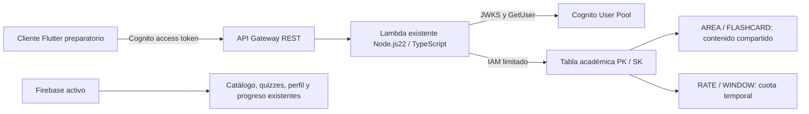

# AWS Parte 3 — DynamoDB y CRUD de fichas

Estado: implementación y pruebas locales; sin despliegue AWS ni migración de Firebase.
Rama: `feat/janely-synapse-development`. Base publicada de Parte 2: `b9f7cf68419dc66fdf7f72cf92714b78289856d9`.

## Auditoría del modelo real

| Entidad existente | Acceso actual | Decisión en esta parte |
| --- | --- | --- |
| MedicalAreaModel | Catálogo Firestore, orden y disponibilidad | Sigue en Firebase; no se crea otra tabla |
| TopicModel | Temas por área, orden y conteos | Sigue en Firebase |
| CheatsheetModel | Fichas por área/tema, contenido Markdown | Primer CRUD DynamoDB; conserva sus campos |
| QuizModel | Preguntas por área/tema | Sigue en Firebase; sin migración |
| Usuario | Firebase Auth/perfil; Cognito solo staging debug | Sin mezclar UID Firebase y sub Cognito |
| QuizTopicProgressModel / QuizAttemptModel | Progreso por usuario/tema, intento activo y hasta tres históricos | Conservados en Firebase |
| ProgressSummary / historial académico | Estadísticas derivadas e intentos realmente retenidos | No se recalculan ni migran |

El servicio `medical_areas_service.dart` mantiene las lecturas existentes. El nuevo cliente es preparatorio y se verifica con transporte local en pruebas; Flutter no consume este CRUD en producción. No hay interfaz administrativa nueva, cambios de diseño ni datos precargados.

## Modelo y patrones de acceso

Una tabla compartida de contenido académico, sin tabla por entidad. El contenido privado no se mezcla: la tabla futura de historial ya existente sigue desactivada.

| Registro | PK | SK | Atributos |
| --- | --- | --- | --- |
| Ficha | `AREA#<areaId>` | `FLASHCARD#<UUIDv4>` | Campos del modelo, id, version, createdAt, updatedAt |
| Cuota temporal | `RATE#<SHA256(sub)>` | `WINDOW#<inicio-segundos>` | count, expiresAt |

Campos de ficha: `areaId`, `topicId`, `title`, `summary`, `contentMarkdown`, `keyPoints`, `mnemonics`, `readDurationInMinutes`, `isPremium`, `sourceBook`. El alias heredado `readMinutes` no se envía a esta API. `isPremium` es metadato: esta parte autoriza lectura por autenticación y no implementa pagos o nuevas reglas de suscripción.

- UUIDv4 y fechas UTC se generan en el servidor. `id` es base64url canónico de `[areaId, UUIDv4]`; contiene ubicación, nunca un secreto. PK/SK internos no se devuelven.
- `areaId` es inmutable. IDs de área/tema: letras, números, guion y guion bajo, longitud 1–128. Crear/cambiar referencias no consulta Firestore: se valida formato, no existencia. Antes de activar/importar, debe aprobarse el mapeo de catálogo; no hay claves foráneas automáticas.
- Listar exige área; Query por PK y prefijo de SK, con filtro opcional de tema. No Scan ni GSI: no se requiere lectura global o búsqueda por otro atributo en esta fase.
- Límite predeterminado 20, máximo 50 elementos evaluados. Un filtro puede producir página vacía con cursor: continuar hasta `nextCursor=null`. Cursor ligado a área/tema/última clave; orden por UUID, no cronológico.
- Lecturas consistentes. PATCH/DELETE requieren `If-Match: "<version>"`; escrituras condicionales evitan sobrescrituras. Versión obsoleta:409; ficha ausente:404. Crear también usa condición de ausencia.
- TTL solo se establece en contadores, nunca en fichas; la expiración física es eventual y no determina autorización. Cuota de ventana fija, no límite deslizante: dos ventanas contiguas pueden admitir dos cuotas.



## Contrato REST

| Método y ruta | Acceso | Éxito |
| --- | --- | --- |
| GET /api/v1/flashcards?areaId=...&topicId=...&limit=20&cursor=... | Cognito autenticado | 200, data:{items,nextCursor} |
| GET /api/v1/flashcards/{id} | Cognito autenticado | 200, data:ficha, ETag |
| POST /api/v1/flashcards | Grupo firmado admins | 201, data:ficha, ETag y Location |
| PATCH /api/v1/flashcards/{id} | Grupo admins + If-Match | 200, data:ficha y ETag nuevo |
| DELETE /api/v1/flashcards/{id} | Grupo admins + If-Match | 204, cuerpo vacío |

Errores JSON: `{error:{code,message},requestId}`; mensajes seguros. 400 entrada/versión/cursor inválidos;401 token ausente/inválido;403 escritura no administrativa;404 ausente;409 conflicto;429 cuota excedida con Retry-After;500 fallo interno inesperado;503 servicio/cuota no disponible. También405 método incorrecto,413 cuerpo mayor de16KiB y415 Content-Type incorrecto. Sin trazas internas; logs solo requestId/código seguro.

POST requiere área, tema, título y Markdown; los campos opcionales tienen valores vacíos/cero/false compatibles con el modelo. PATCH acepta únicamente campos académicos mutables. No se aceptan roles, versiones o fechas proporcionados por clientes.

## Seguridad, configuración e infraestructura

- Cognito: firma/JWKS, issuer/client/token_use/exp/sub y GetUser para revocación/usuario deshabilitado. Firebase tokens no autorizan este CRUD. Grupos provienen del JWT firmado, nunca de body/headers de rol.
- Grupo `admins` vacío preparado por SAM; inscripción no otorga administración. Asignación requiere operación administrativa explícita después del despliegue autorizado. Al retirar privilegios, revocar sesiones: la pertenencia de un JWT vigente no se reconsulta por grupo hasta renovar.
- IAM Lambda permite únicamente GetItem/PutItem/UpdateItem/DeleteItem/Query en la tabla condicionada, además de permisos anteriores. No Scan, creación de tablas ni administración de usuarios Cognito.
- Tabla on-demand, cifrado, PITR y Retain. CloudWatch y Gateway throttling existentes se reutilizan. Cuota atómica por usuario en DynamoDB, SHA256 del sub y TTL. CORS de origen exacto, If-Match permitido, ETag/Location/Retry-After expuestos; CORS no sustituye autorización.
- `EnableCognitoAuth=false`, `EnableFlashcardCrud=false` y `EnableDynamoHistory=false` por defecto. SAM rechaza CRUD activado sin Cognito. Rutas preparadas fallan cerradas cuando faltan pool/tabla.
- `FLASHCARDS_TABLE_NAME`: generado por SAM; `FLASHCARDS_RATE_LIMIT`:60 solicitudes/minuto, rango1–1000; `COGNITO_USER_POOL_ID`, `COGNITO_CLIENT_ID` y `ALLOWED_ORIGIN` existentes. Ejemplo sin secretos en `backend/.env.example`.
- Credenciales DynamoDB se obtienen del rol Lambda; sin claves AWS en Flutter. Runtime no permite redirigir DynamoDB a endpoints arbitrarios mediante variables. SDK: tres intentos, conexión2s y solicitud5s.

## Pruebas locales reproducibles

Requisitos: Node.js22, npm, Java y SAM CLI. Sin Docker, cuenta AWS o despliegue. DynamoDB Local solo conserva fixtures no clínicos en memoria; cada prueba crea y elimina su tabla temporal. Credenciales `local/local` son valores de firma del emulador, no claves AWS.

```sh
npm ci --prefix backend
npm run typecheck --prefix backend
npm test --prefix backend
npm run test:health --prefix backend
mkdir -p /tmp/synapse-dynamodb-local
curl --fail --location https://s3.us-west-2.amazonaws.com/dynamodb-local/dynamodb_local_latest.tar.gz -o /tmp/synapse-dynamodb-local/archive.tar.gz
tar -xzf /tmp/synapse-dynamodb-local/archive.tar.gz -C /tmp/synapse-dynamodb-local
cd /tmp/synapse-dynamodb-local
java -Djava.library.path=./DynamoDBLocal_lib -jar DynamoDBLocal.jar -inMemory -sharedDb -port 8000
# En otra terminal, desde la raíz del repositorio:
DYNAMODB_LOCAL_ENDPOINT=http://127.0.0.1:8000 npm run test:dynamodb --prefix backend
SAM_CLI_TELEMETRY=0 AWS_EC2_METADATA_DISABLED=true sam validate --lint --template-file backend/template.yaml --region us-east-1
flutter analyze
flutter test
```

El servidor HTTP de integración usa loopback y verifica el CRUD completo sobre DynamoDB Local; su transporte de identidad es una fixture, mientras las firmas RSA/JWKS Cognito se verifican en pruebas separadas. Esto no demuestra una sesión o URL real de AWS. El emulador no verifica IAM, CloudWatch, cifrado/PITR o TTL físico: quedan para staging autorizado.

Referencias: [paginación y páginas filtradas](https://docs.aws.amazon.com/amazondynamodb/latest/developerguide/Query.Pagination.html), [escrituras condicionales por versión](https://docs.aws.amazon.com/amazondynamodb/latest/developerguide/BestPractices_OptimisticLocking.html), [grupos firmados de Cognito](https://docs.aws.amazon.com/cognito/latest/developerguide/cognito-user-pools-user-groups.html).

Pendiente: autorización de despliegue, región/cuenta/costos, usuarios administrativos reales, pruebas staging IAM/tokens/endpoint y mapeo/importación auditada del catálogo. Ninguna migración o avance a Parte4 ejecutado.

## Resultado ejecutado (2026-10-12)

- TypeScript typecheck/build correctos. Node.js22:184 pruebas backend y4 HTTP health aprobadas.
- DynamoDB Local:3 integraciones aprobadas (repositorio, HTTP CRUD y cuota distribuida); tablas temporales eliminadas y servidor detenido.
- 61 solicitudes de cuota concurrentes:60 aceptadas y1rechazada con429; aislamiento y nueva ventana verificados.
- SAM CLI1.168.0 validate --lint:plantilla válida. npm audit producción:0 vulnerabilidades.
- Flutter analyze sin incidencias;248 pruebas aprobadas. Ningún cambio UI/nativo: no se ejecutó una nueva compilación iOS en esta parte.
- Revisión final de diferencias y secretos antes de publicar; sin despliegues AWS, migración, producción Cognito o usuarios administrativos creados.

Commits de código publicados y verificados en GitHub:

- [cd2dc1349e812bb1f88a8ec7b7ba523e105ec236 — backend](https://github.com/bryanapazaquispev5-droid/synapse-health/commit/cd2dc1349e812bb1f88a8ec7b7ba523e105ec236).
- [5ff5846d8851c75791d7249540201c0ca737c732 — Flutter](https://github.com/bryanapazaquispev5-droid/synapse-health/commit/5ff5846d8851c75791d7249540201c0ca737c732).
