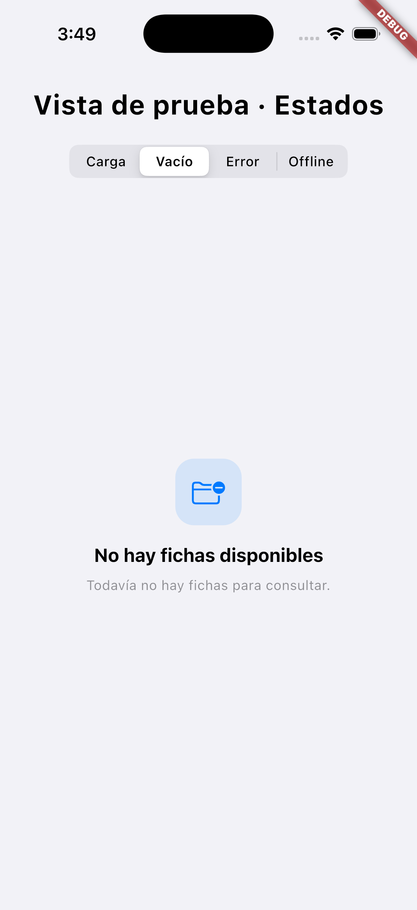
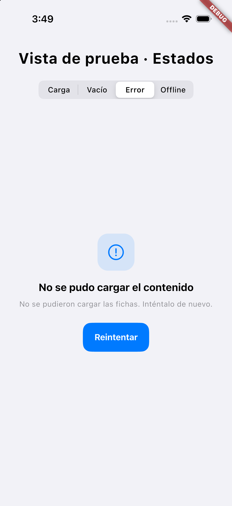
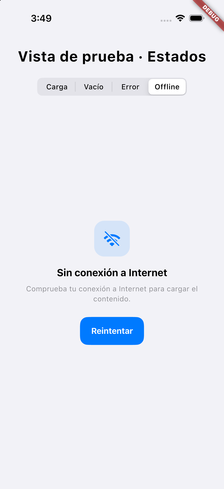
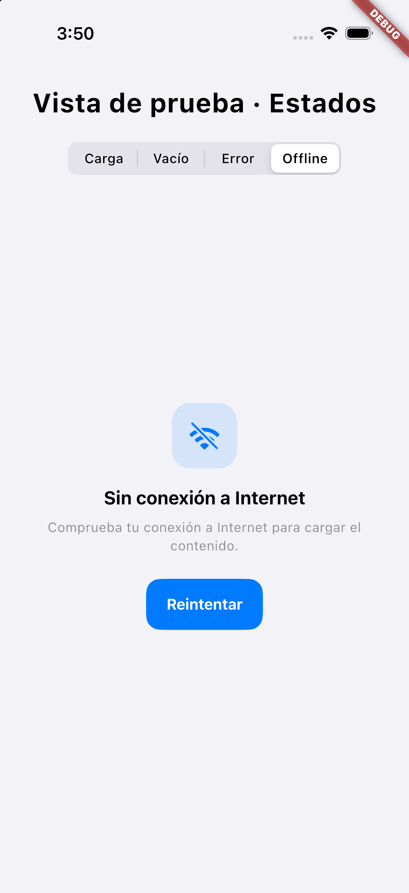

# Fase 2 — Estados reutilizables

## Alcance implementado

Se extrajo el estilo de los estados de fichas existentes, conservando AppTheme y AppColors.
Los componentes residen en lib/core/widgets/states y no agregan dependencias.

| Componente | Uso |
|---|---|
| AppLoadingState | Indicador Cupertino de radio 14; modo compacto radio 8 para cargas parciales |
| AppEmptyState | Mensaje contextual, icono existente y acción opcional como limpiar búsqueda |
| AppErrorState | Mensaje seguro y reintento cuando la operación es recuperable |
| AppOfflineState | Falta de conexión sin afirmar persistencia local de contenidos |
| AppMessageState | Composición compartida: tile azul 64/radio18, título18, texto13, padding28, botón radio14 |
| AppAsyncStreamBuilder / AppAsyncSnapshot | Suscripción estable, último dato recibido y reintento mediante nueva operación |
| AppAsyncStatus / AppAsyncNotice | Estado principal o aviso parcial conservando contenido disponible |

Los wrappers CheatsheetEmptyState y CheatsheetOfflineState delegan a los componentes compartidos.
No se agregó Not Found ni Under Development: la auditoría no identificó un flujo real que lo necesitara.

## Pantallas integradas

- Fichas: CheatsheetListScreen, AreaTopicsScreen, TopicCheatsheetsScreen.
- Quizzes: QuizAreasScreen, QuizListScreen, AreaQuizzesScreen, QuizTopicsScreen, TopicQuizzesScreen.
- Ranking: LeaderboardScreen.
- QuizTopicCard muestra carga parcial o progreso no disponible sin usar métricas provisionales.
- QuizTopicProgressBadge muestra las estrellas recibidas sin inventar un máximo de 20 cuando falta ese dato.
- Encabezados existentes de TopicQuizzesScreen se extrajeron a topic_quizzes_header.dart conservando su diseño.

Las cabeceras, buscadores y navegación se conservan. Los estados principales ocupan la zona de contenido;
los datos disponibles permanecen durante una interrupción con un aviso parcial.
Las acciones que requieren progreso en TopicQuizzesScreen esperan un resultado válido.
Un dato null recibido significa ausencia real de progreso; no equivale a una petición todavía en curso.

## Errores y conexión

- permission-denied/unauthenticated se muestran como errores de acceso, incluso si la conexión falla.
  Se descarta el contenido del snapshot cuando su autorización es revocada.
- unavailable/deadline-exceeded se muestran offline solo si también falla la comprobación de conexión.
  Con conexión disponible se muestran como errores recuperables del servicio.
- Excepciones internas no aparecen en los mensajes de usuario; se registran con error y stack para diagnóstico.
- Reintentar comprueba conexión y crea una nueva lectura. El ranking reinicia su stream de lectura y caché existente.
- Cambios de conectividad no desmontan la suscripción ni convierten errores en listas vacías.
- El sondeo HTTPS de www.gstatic.com/generate_204 evita depender de DNS cacheado y agrupa comprobaciones simultáneas.
  Cualquier respuesta HTTPS confirma alcance de red, incluso HTTP503; no demuestra que Firestore funcione.
- Un sondeo no garantiza el estado de toda Internet: bloqueo específico del host, TLS o timeout puede hacerlo fallar.
- Firestore sigue sin persistencia en disco. La conservación es de datos recibidos en memoria durante esta sesión;
  no se garantiza disponibilidad tras reiniciar ni sincronización de escrituras offline.

## Validación real

- flutter analyze: sin incidencias, exit0 (3,2 s).
- flutter test: 55 pruebas aprobadas, exit0; 29 previas y 26 nuevas.
- Cobertura nueva: cuatro estados, acciones, accesibilidad con escala2,5, viewport320x240,
  slivers, permisos vs offline, error vs vacío, dato null, reconexión/reintento, descarte de datos revocados,
  cancelación de suscripciones, alcance HTTPS y contador/progreso desconocido.
- Hubo fallos iniciales de sincronización de pruebas y un reintento bloqueado por esperar cancelación;
  se corrigieron los frames esperados, teardown de controllers y suscripción sin esperar limpieza del transporte.
- flutter run con lib/main.dart: compilación Xcode en 19,9 s, sincronización198 ms, conexión VM y login visible
  en iPhone17/iOS26.5. No se autenticó ni creó ningún estudiante real para esta validación.
- Aviso previo de Google Sign-In sobre UIScene permanece; no impidió compilar ni arrancar.
- Los componentes se comprobaron visualmente en una entrada temporal de QA aislada y posteriormente
  se restauró lib/main.dart. Esa entrada no forma parte del repositorio ni de la navegación del producto.

## Capturas de componentes en iPhone 17

Las capturas corresponden a QA aislada de los widgets reales, sin consultas Firebase ni datos de usuario.
Los flujos autenticados completos requieren una cuenta autorizada y no se declaran comprobados por estas imágenes.

## Archivos de la fase

- lib/core/services/connectivity_service.dart e internet_connection_probe.dart.
- lib/core/widgets/states/app_states.dart, app_message_state.dart, app_async_stream_builder.dart y app_async_content.dart.
- Las nueve pantallas enumeradas arriba, wrappers de fichas, QuizTopicCard, QuizTopicProgressBadge y topic_quizzes_header.dart.
- test/core/services/internet_connection_probe_test.dart.
- test/core/widgets/app_states_test.dart, app_async_stream_builder_test.dart y fixtures/async_content_fixture.dart.
- test/features/quizzes/quiz_topic_card_states_test.dart.
- docs/PLAN_DESARROLLO_JANELY.md, este informe y cuatro capturas docs/evidence/phase2.

No se cambiaron autenticación, reglas Firestore, puntuación, reintentos de quizzes ni esquema de datos.
Los cambios de métricas son de presentación de valores desconocidos, sin cálculos nuevos.
Fase 3 permanece sin iniciar.

## Publicación verificada

- Componentes y pruebas: 340daacd8daf082329d63b445740ac46a74dd612.
- Integración en pantallas: a6a01e596a79ebe82d83d335a07892dbbdb3b2fa.
- Ambos SHA comprobados en origin/feat/janely-synapse-development mediante Git y API GitHub.
- Informe, plan maestro y capturas publicados en un commit de documentación separado.
