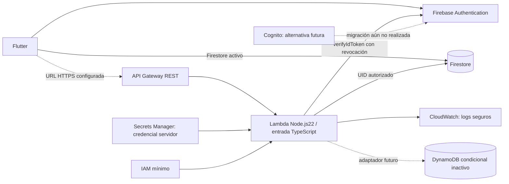
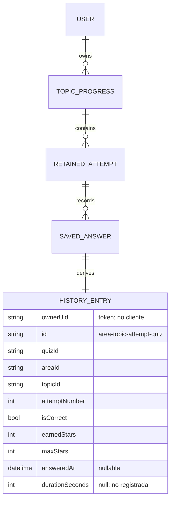

# Fase 5 — Historial académico y AWS

Estado: implementación y validación local completas; AWS obligatorio en la arquitectura objetivo, sin despliegue autorizado. Código publicado y verificado en feat/janely-synapse-development: da13b2eea493998f10e86dce16c24e010e178455 y c6d0555616c773878f744a66c41cba833dfa15a9. Documentación y capturas se publican con esta actualización.

## Funcionalidad Flutter

Progreso incorpora «Mi historial» sin otra pestaña inferior. Lista de respuestas guardadas, más recientes primero, tarjetas compactas, nombre real del quiz, área, fecha, resultado, estrellas e intento. «Mostrar más» revela grupos de20; el detalle sigue disponible mientras el intento permanezca conservado. Ranking, fichas, quizzes, perfil y transiciones existentes se conservan. No se implementó el Dashboard ausente de Fase3 ni otra fase.

El historial reutiliza QuizTopicProgressModel, QuizAttemptModel, QuizQuestionProgressModel y los servicios del catálogo. Una fila representa una pregunta contestada dentro de un intento por tema, no demuestra que una sesión completa terminó. Puntuación disponible: correcta/incorrecta y estrellas ganadas/máximas; no se inventan puntos adicionales.

Solo `answeredAt` aporta una fecha real. Fechas ausentes aparecen como «Fecha no disponible»; tiempo como «No registrado». No se usan startedAt sintetizado ni completedAt de un reintento parcial como prueba de duración. La política conserva tres intentos históricos **por tema**, más el activo; no hay historial vitalicio ni recuperación de registros que ya salieron del FIFO.

Nombre/pregunta, tema y área provienen del catálogo actual. Si el contenido fue eliminado o perdió su título, se indica que no está disponible. No se afirma conservar la versión histórica del enunciado ni se interpreta selectedOptionIndex contra opciones barajadas actuales.

Estados Loading, Empty, Error, Offline y acceso inválido reutilizan Fase2. Cambio de UID, pérdida de sesión/permisos y retirada de un intento invalidan el contenido privado. Nombres del catálogo se consultan una vez por grupo de área/tema, con suscripciones canceladas al desmontar. No se añaden filtros sin necesidad ni estadísticas ficticias.

## Auditoría: distribución de operaciones

| Operación | Fuente actual | Arquitectura objetivo |
| --- | --- | --- |
| Login, Google, sesión, recuperación | Firebase Authentication | Conservar; Cognito requiere migración aparte |
| Catálogo, perfil/progreso propios, ranking leído | Firestore con reglas | Conservar streams durante transición |
| Respuestas de práctica y reintentos | Firestore, transacciones existentes | Conservar hasta protocolo AWS verificado |
| Historial privado | Firestore; REST cuando se configure endpoint | API Gateway → Lambda → persistencia autorizada |
| Ranking verificado, evaluación oficial | Cliente no puede escribir ranking | AWS con evaluación confiable en servidor |
| Publicación administrativa, roles, agregados oficiales | No añadido aquí | AWS autenticado/autorizado en fase posterior |
| FCM y notificaciones | Firebase y servicios existentes | Conservar |

La práctica existente es autorreportada: el cliente conoce respuestas correctas y calcula estrellas. No se transforma en ranking certificado por mover esas variables a Lambda. Una evaluación confiable necesita respuestas crudas, clave privada del servidor, idempotencia y reglas verificadas. Esta fase no cambia puntuación, reglas Firestore ni resultados.

## Arquitectura implementada/preparada

Código recuperado de la sesión interrumpida se conserva modularmente. La entrada Lambda está tipada en TypeScript; los módulos JavaScript previos siguen operativos y son compilados y copiados a dist por TypeScript. No se reescribió todo el backend para cambiar extensión.

API Gateway regional, Lambda22/ARM64, IAM y CloudWatch están descritos en `backend/template.yaml`. El rol solo lee el ARN concreto de Secrets Manager y escribe en su log group; no tiene permisos de DynamoDB. No hay credenciales en la app, variables de entorno ni repositorio: solo referencias/configuración. `.env.example` contiene placeholders.

La validación de token se ejecuta en Lambda con Firebase Admin SDK y comprobación de revocación; no se configura un autorizador Cognito ni se asume compatibilidad automática con tokens Firebase. El UID verificado selecciona la ruta privada, nunca un userId suministrado por el cliente. [Verificación oficial Firebase](https://firebase.google.com/docs/auth/admin/verify-id-tokens).

El Admin SDK ignora reglas de clientes: autorización explícita, whitelists e IAM son obligatorios en servidor. Las reglas Firestore existentes permanecen vigentes para Flutter. El contador servidor `backend_rate_limits/{sha256(uid)}` queda inaccesible a clientes por la regla final de denegación. [Acceso seguro de servidor](https://firebase.google.com/docs/firestore/security/rules-query).

## Endpoints

| Método | Ruta | Estado local |
| --- | --- | --- |
| GET | `/api/v1/health` | Liveness público; no certifica Firestore disponible |
| GET | `/api/v1/history` | Token validado, propietario, orden y paginación |
| GET | `/api/v1/history/{id}` | Detalle exclusivamente del propietario |
| GET/PATCH | `/v1/me/profile` | Preparación previa conservada y probada; edición Flutter sigue en Firebase |

Success `{data,requestId}`; error `{error:{code,message},requestId}`. Validaciones de métodos, rutas, queries, IDs, JSON, campos y tamaño. Manejo HTTP400/401/403/404/405/409/413/415/429/500/503. Errores internos no se muestran ni registran con token, UID, cuerpo o credencial.

Paginación `limit=1..50` (default20) y cursor del propietario. ID canónico: Base64URL sin padding de `[areaId,topicId,attemptNumber,quizId]`. No representa autorización. Cursor eliminado devuelve409; refresh recarga. Cada página consulta un snapshot nuevo; modificaciones simultáneas no garantizan una exportación congelada.

Flutter muestra inmediatamente la primera página y solicita las siguientes únicamente al pulsar Mostrar más, sin gastar la cuota en una carga completa anticipada. Un fallo posterior conserva el contenido cargado con aviso recuperable.

Firestore guarda arrays/mapas anidados sin índice global de fechas por respuesta. Se leen como máximo201 documentos de temas; más de200 produce503 explícito. No se trunca silenciosamente. Flutter protege respuestas a1MiB y acumulación a10000 entradas. Estos límites deben sustituirse por consultas indexadas al escalar.

Límites: API Gateway10 solicitudes/s compartidas y burst20, más30/min por UID con transacción Firestore. El límite por usuario usa ventana fija y puede permitir burst entre ventanas. `Retry-After` acompaña429. El límite de Gateway es mejor esfuerzo, no un tope de gasto. [Throttling oficial AWS](https://docs.aws.amazon.com/apigateway/latest/developerguide/api-gateway-request-throttling.html).

CORS acepta un origen HTTPS exacto; sin wildcard. Clientes nativos sin Origin funcionan. API Gateway prepara OPTIONS y respuestas de throttling; Lambda incluye CORS en respuestas de la aplicación. Logs CloudWatch retención14d; DataTrace desactivado, concurrencia5.

## Modelo de datos y migración futura

Ruta real Firestore: `users/{uid}/quiz_topics_progress/{topicId}`. DTO derivado, sin nueva colección académica ni campos inventados persistidos. El topicId como clave puede colisionar entre áreas; una migración debe detectar este problema, no fabricar registros perdidos.

DynamoDB futuro: `userKey=USER#<firebaseUid>`, `entryKey=ENTRY#<id>`, GSI ByDate con userKey y `historyOrder=D#<UTC-ISO>#<id>` para fechas conocidas, `A#<id>` para desconocidas; consultas descendentes dejan desconocidas al final. Guardar identidad Firebase y una eventual correspondencia Cognito, sin reemplazarla silenciosamente.

Plan de migración, no ejecutado:

1. Exportar respaldo cifrado de documentos originales y manifiesto de recuentos/checksums; fijar un punto de corte o ventana controlada de escrituras.
2. Convertir únicamente registros conservados reales, preservando UID, área, tema, intento, resultado, estrellas y fecha nullable; duración continúa null. Mantener copia del documento original para trazabilidad.
3. Escribir idempotentemente por owner+ID, verificar conteos/hash/fechas, muestras y autorización; los históricos descartados previamente no se recuperan.
4. Preparar adaptador DynamoDB, consultas paginadas por fecha y estrategia de cambios posteriores al corte. Evitar doble escritura no transaccional entre nubes.
5. Validar staging, aislamiento por UID y rollback a Firestore. Activar lectura AWS/DynamoDB después de aprobación, sin eliminar fuente original ni reglas hasta comprobar equivalencia.

La tabla condicional tiene cifrado y PITR, Retain y PAY_PER_REQUEST; `EnableDynamoHistory=false` evita crearla por defecto. Activarla no añade un adaptador ni migra datos. Cognito no está en login y requiere plan/pruebas propios.

## Validación ejecutada

- flutter analyze: sin incidencias, 3,7s.
- flutter test: **166 aprobadas**; dominio, contrato compartido, repositorio, cliente REST, lista/detalle, navegación, estados y pruebas anteriores.
- Node.js22: **78 aprobadas**, incluyendo31 recuperadas, historial, token/revocación, CORS, permisos, HTTP, rate limiter y persistencia.
- Authentication + Firestore Emulator Suite: **2 integraciones reales aprobadas**, identidad/token del emulador, UID, paginación, detalle y transacciones.
- Reglas Firestore: **19 pruebas aprobadas**.
- TypeScript typecheck/build: correctos; Lambda artifact preparado en dist (ignorado).
- cfn-lint con transform SAM: plantilla válida sin incidencias. No SAM CLI, AWS CLI o Docker instalados; no se afirma ejecución local mediante Docker ni validación de cuenta AWS.
- npm audit de producción: **0 vulnerabilidades**. SDK Admin nuevo actualizado a14.5.0 para corregir transitivas; sin cambios en pubspec o FlutterFire.
- iPhone17/iOS26.5, flutter run real: build19,4s, sync119ms y VM activa. Vista vacía aislada, marcada como prueba, build24,8s/sync113ms; captura revisada. Arranque real restaurado: build18,4s/sync101ms; compilación final tras paginación: build18,8s/sync88ms, VM activa.
- git diff y diff --check revisados; archivos fuente menores de250líneas. Herramienta codebase-memory solicitada por AGENTS no disponible; inspección directa y acotada.

La verificación local no acredita despliegue AWS, JWT válidos de producción, credenciales/IAM reales ni sesiones de estudiantes en producción. Aviso Google Sign-In UIScene previo persiste. Persistencia Firestore en disco permanece desactivada; no se promete recuperar datos offline tras reiniciar.

## Archivos y siguientes pasos

Flutter: `lib/features/academic_history/**`, `lib/core/api/**`, enlace mínimo en personal_progress y pruebas/fixture compartido. Backend: `backend/src/**`, tests, package/lock, tsconfig, plantilla, .env.example y README. Configuración de emuladores separada en raíz; .gitignore excluye dist/node_modules/config local. Evidencias: `docs/evidence/phase5`.

Pendiente exclusivamente de despliegue y transición: autorización de costos, cuenta/región, IAM Google/AWS/Secrets/KMS, validación staging y URL real para `SYNAPSE_API_BASE_URL`. Historial mantiene Firestore hasta entonces; AWS configurado no hace fallback silencioso ante401/403/errores. DynamoDB, Cognito y evaluación oficial quedan pendientes del plan de migración. Instrucciones reproducibles: backend/README.md.

Detenerse al finalizar esta fase. No avanzar al Prompt7 ni ejecutar migraciones/despliegues.

## Publicación y estado externo

Push 75cfbcf → c6d0555 confirmado por GitHub API y git ls-remote, cuenta janelyapazasencia95-sketch con permiso push. Revisión de50 archivos sin secretos detectados; .env.example contiene solo configuración no secreta. El artefacto Lambda compilado respondió HTTP200 al health local, sin acceso a servicios remotos.

Durante la verificación, main remoto avanzó por un commit del propietario bryanapazaquispev5-droid a22e4c1aa50fb91ada77d112e134f0f302a398eba. No se incorporó ni modificó en esta fase: todos nuestros commits/push corresponden únicamente a la rama autorizada. testIv sigue en da55709c53b27f6e6d0ae6cd50ff5d9333f996be; main local conserva su estado anterior. Una eventual integración con main debe revisar diferencias antes de fusionar.
